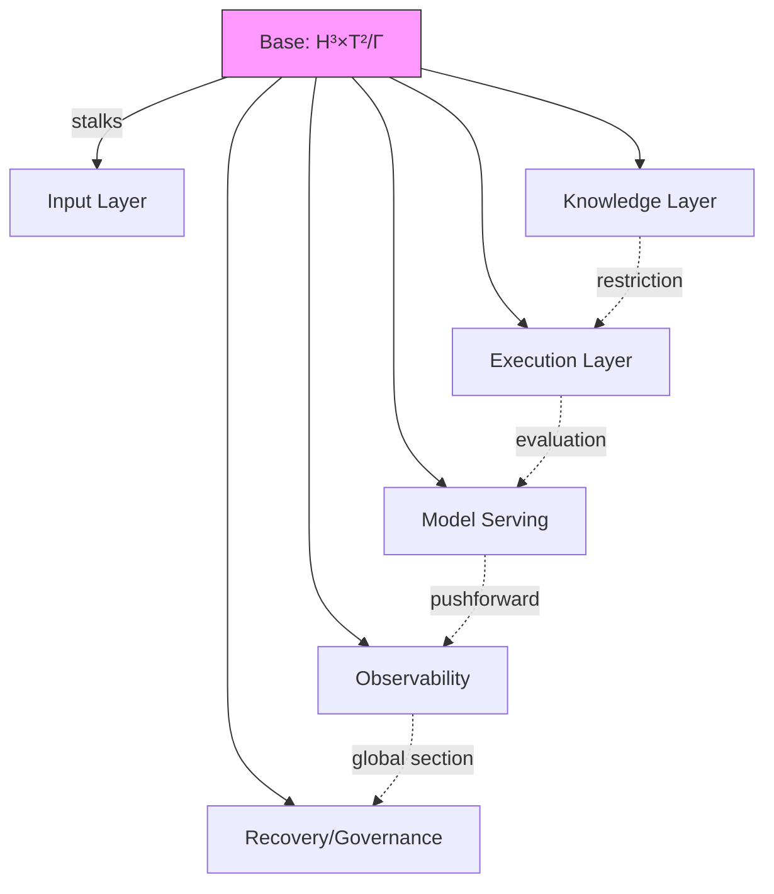

# C04 — Architecture Topology & System Tree

**Status.** PROPOSED. **Parent:** Master Design Document index.

## Purpose

Single canonical architecture tree for the enterprise scope, used as the implementation map.

## Subcategories (broad topics)

- C04.1 Input Layer (session/gatekeeping, permission tiers, endpoint registry, secret slots)
- C04.2 Knowledge Layer (skill registry/tree, hooks, Mind, RAG+ingest, workflows/task graph)
- C04.3 Execution Layer (typed tool registry, hole substrate, context budgeting/compaction, code intel)
- C04.4 Integration Layer (MCP runtime, cross-tool import, endpoints)
- C04.5 Multi-Agent Layer (lanes, autorunner, subagent loops, parallel orchestration, branch isolation, holonomy brigade)
- C04.6 Model Serving Layer (standard transformer, Atlas, hyperbolic cache, TwisterAttention, telemetry, security)
- C04.7 Observability Layer (event ledger, telemetry, metrics, neural map roll-up)
- C04.8 Recovery & Governance (circuit breakers, retry signatures, idempotency, rule set, compliance smoke)
- C04.9 Cross-cutting concerns (config, settings, feature flags, migration)

## Formal Architecture: Sheaf-Theoretic System Topology

The architecture is not a tree—it is a **sheaf of computational resources over the hyperbolic base manifold** $\mathcal{B} = \mathbb{H}^3 \times \mathbb{T}^2 / \Gamma_{12}$.

### Base Manifold & Stalks

- **Base $\mathcal{B}$**: Lorentz hyperboloid $H^3$ (canonical) with Picard reduction $\Gamma = PSL(2,\mathbb{Z}[i])$, fibered with toroidal phase $T^2$. Each stalk $\mathcal{F}_x$ at $x \in \mathcal{B}$ is a **typed computational capability** (tool, skill, memory region, model slice).
- **Restriction maps $\rho\_{xy}: \mathcal{F}\_y \to \mathcal{F}\_x$** for $x \preceq y$ (radial order): moving toward origin (higher precision) restricts capabilities to higher-fidelity subsets; moving outward compresses.
- **Global sections $\Gamma(\mathcal{F})$**: coherent configurations of the entire system (lane rosters, skill trees, hook manifests, Atlas state).

### Layer Assignment as Sheaf Cohomology

The 8-layer architecture maps to a **filtration of sheaves**:

$$
\mathcal{F}^{(1)} \hookrightarrow \mathcal{F}^{(2)} \hookrightarrow \cdots \hookrightarrow \mathcal{F}^{(8)} = \mathcal{F}
$$

where each inclusion adds a capability layer. The **obstruction to global section existence** is exactly the **compliance/security gap**—hence C03.7 (security before build) ensures $H^1(\mathcal{B}, \mathcal{F}_{security}) = 0$ before feature layers are added.

### Data Flow as Morphisms

- **Input Layer $\to$ Knowledge Layer**: Pullback along observation map $obs: \mathcal{B} \to \mathcal{O}$
- **Knowledge Layer $\to$ Execution Layer**: Pushforward of typed tool registry along skill activation
- **Execution Layer $\to$ Model Serving**: Evaluation map $ev: \mathcal{F}_{model} \times \mathcal{F}_{context} \to \mathcal{F}_{output}$
- **Observability**: Global section of the **telemetry sheaf** $\mathcal{T}$ with stalks $(counts, ids, latency)$

### Holonomy Brigade as Parallel Transport

The **Holonomy Brigade** (C06.13 / C30.6) is **parallel transport of model weights along geodesics in $\mathcal{B}$**:

- Single weight set $W$ (global section of $\mathcal{F}_{weights}$)
- Specialist $i$ receives $P_{\gamma_i}(W|_{U_i})$ where $\gamma_i$ is geodesic from origin to submanifold $U_i$
- Dissolution = parallel transport back along $\gamma_i^{-1}$
- **Invariant**: $\bigotimes_i P_{\gamma_i}(W|_{U_i}) \cong W$ (no weight cloning)

### Cross-Cutting Concerns as Sheaf Endomorphisms

- **Config/Flags**: Endomorphisms of $\mathcal{F}$ preserving stalks
- **Migrations**: Morphisms of sheaves inducing isomorphisms on global sections
- **Feature flags**: Subsheaf inclusions/exclusions

## Architecture Diagram (Mermaid)



## Open questions / gaps

- Numbering in original doc must be normalized; cross-reference by ID not by section number.

---

## Contributor Deepening — Muse (2026-10-26)

### C04.10 Layer dependency DAG and build/test independence (depth, not novelty)

The sheaf filtration `F(1) ↪ … ↪ F(8)` implies a build order, but sprint parallelization needs the _independence_ relation: which layers can build and test against stubs. Frozen DAG [PROPOSED — derived from the §8 tree in this file; no build graph exists yet]:

```
C17 (data root/workspace) ─┬─→ C31 (ledger/telemetry) ──→ C25 (holes/receipts)
                           │         │                         │
                           │         ▼                         ▼
                           │      C29 (tools) ──→ C28 (skills/hooks) ──→ C30/C34 (lanes)
                           │                                                   │
                           └─→ C26 (RAG/ingest) ──→ C07 (memory) ──→ C24 (compaction)
                                      │
C05 (Atlas/geometry) ──→ C12 (serving) ──→ C18 (transport) ──→ C19 (IDE surfaces)
   │                          │
   └─→ C35 (interop)          └─→ C21 (budgets) + C22 (runbooks)
```

- **Roots (build first, stub for nobody):** C17, C05/C35 geometry, C31 ledger schema.
- **Parallelizable once roots stubbed:** C28 vs C29 vs C26 (no edges between them).
- **Convergence points (integration risk):** C30 lanes (needs C28+C29+C25), C12 serving (needs C05+C31), C18/C19 (need everything below).
- **Cross-cutting (bind last):** C20 config/flags, C16 security sign-off (Gate 1, before Day 1 feature code per C03.7), C33 docs lint, C15 gates.

[INFERRED — DAG follows from dependency statements across C05/C28–C31/C17/C25; ends at those files. Verify against C14 assembly + C32 sprint order at those categories.]

### C04.11 Failure isolation matrix (which layer failures stay local)

| Failing layer  | Contained (degrades locally)                | Cascades (takes down)                     | Isolation mechanism                          |
| -------------- | ------------------------------------------- | ----------------------------------------- | -------------------------------------------- |
| C26 ingest     | RAG staleness → BM25-only fallback (ADR-02) | —                                         | Honest-BM25 default                          |
| C28 hook veto  | Single action denied                        | —                                         | Veto receipt; no lane kill                   |
| C25 hole       | Single task fails with receipt              | —                                         | Seatbelt + budget caps (ADR-12)              |
| C24 compaction | Single agent restarts from checkpoint       | —                                         | Pinned messages + checkpoint                 |
| C30 lane       | Lane isolated, others continue              | Swarm if interference `I < 0.1` unhandled | Breaker at `I < 0.1` (ADR-14)                |
| C05 Atlas      | All recall degrades                         | C12 serving, C07 memory, C24 recovery     | Kill switch to standard transformer (ADR-05) |
| C12 serving    | Everything above stalls                     | Full system                               | Shadow-mode + staged rollout (C10)           |
| C31 ledger     | Receipts unrecorded (ship-blocker)          | Audit/compliance claims                   | Separate PID, persisted session (ADR-16)     |

**Rule:** any failure not in the "Contained" column with a named mechanism is a ship-blocker until the mechanism exists and is gate-tested (C15 Gate 6 chaos/recovery).

What was NOT checked here: C22 runbook coverage per row (verify at C22); C32 task ordering vs this DAG (verify at C32).

---

## Source detail migrated from `01-Aers-SpecialOperations-Agentic-Lab-Design-Overview.md`

## 4. Comprehensive architecture tree

```
Ares Enterprise (hackathon scope)
├── 1. Input Layer
│   ├── Session/gatekeeping, permission tiers, endpoint registry, secrets slots
│   ├── Agent configurations (N lanes, not fixed 3), rag_default, rag_collection
│   └── IDE/terminal entry, revision-gated saves
├── 2. Knowledge Layer
│   ├── Skill registry + tree (depends_on, topo sort, lazy/eager)
│   ├── Hooks (event map, blocking veto, receipts)
│   ├── Mind (5W run summaries, role-gated)
│   ├── RAG (in-process, BM25+dense, 7 collections) + ingest (Ingest role)
│   └── Workflows/task graph (packets, judges, retry, escalation, preregistration)
├── 3. Execution Layer
│   ├── Typed tool registry (built-in + code-intel + git write + web)
│   ├── Hole substrate (create/run/diff/approve/merge, Merkle guards)
│   ├── Context budgeting + compaction (60% fold, post-compaction restart)
│   └── Code intelligence (Tree-sitter/LSP) gated by settings
├── 4. Integration Layer
│   ├── MCP runtime (lazy sessions, stdio/HTTP, preset catalog)
│   ├── Cross-tool import (read-only scan + explicit import)
│   └── Endpoints (OpenAI-compatible, embed lane discovery)
├── 5. Multi-Agent Layer
│   ├── Lanes (configurable, not fixed)
 |     |-----Hyperbolic mMap -- Siloed Multi-Agent Temporary Allocation
 |     |-----Agentic Harness Theory
│   ├── Autorunner (N workers, ready-packet admission)
│   ├── Subagent loops (holes as substrate, depth/budget caps)
│   ├── Parallel orchestration (run_workflow: agent/parallel/pipeline/phase)
│   ├── Branch isolation (holes / worktrees)
│   └── Holonomy Brigade (specialists carved from the Atlas as fibers, not weight clones; dissolve back)
├── 6. Model Serving Layer (NEW — from Difference 1)
│   ├── Standard transformer path (frontier knowledge, agentic team at scale)
│   ├── Atlas — Multi-Model Phase State Space
│   │   └── Hyperbolic Memory Map (Poincaré ball coordinates)
│   ├── Nested Hyperbolic Poincaré Dynamic Phase-State cache (plug-in)
│   ├── TwisterAttention (Active Inferencing Transformer, ACFT)
│   ├── Telemetry/diagnostics as first-class (tok/s, cache hit, recall depth, OOM headroom)
│   └── Security/compliance as first-class (RBAC, audit log, receipts)
├── 7. Observability Layer
│   ├── Event ledger (SQLite, append-only, monotonic)
│   ├── Telemetry (process + persisted session, honest availability)
│   ├── Metrics (Prometheus text), taps, receipts, fingerprints
│   └── Neural Map aggregation (end-of-day roll-up)
└── 8. Recovery & Governance
    ├── Circuit breakers, retry signatures, idempotency keys
    ├── Rule set (30-rules-and-governance), decision/success/failure logs
    └── Compliance smoke + AI Act/GDPR mapping
```

---
