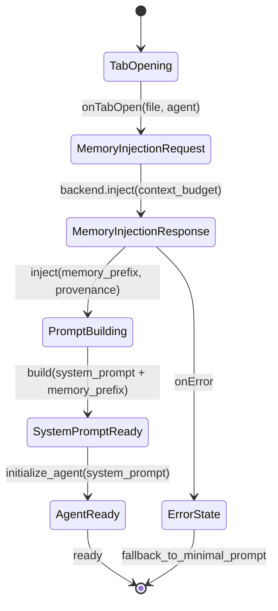

# C19 — Frontend, IDE Surfaces & UX

**Status.** Scaffolded; detail pending. **Parent:** Master Design Document index.

## Purpose

UI panels, file-tab flows, system prompt injection surfaces, and performance risks.

## Subcategories (broad topics)

- C19.1 File-tab open flow and memory injection trigger
- C19.2 Panels: Settings, Swarm Board, Runs, Holes, Memory, Skills
- C19.3 Bundled asset serving (include_dir!) and dev vs release
- C19.4 Frontend chunking and LCP risk (C14.1)
- C19.5 Accessibility and keyboard flows
- C19.6 Error/empty/loading states and honest degradation
- C19.7 Configuration UI for lanes/RAG/feature flags

## Open questions / gaps

- Browser E2E ownership and flakiness remediation.

## Formal UI Specification

### C19.1 File-Tab Open Flow as State Machine



**Timing budget**: Total < 100ms (measured in telemetry).

### C19.2 Panel Specifications (State + Actions)

| Panel       | State                        | Actions                           | Data Source                    |
| ----------- | ---------------------------- | --------------------------------- | ------------------------------ |
| Settings    | Config, FeatureFlags         | Save, Reset, Export               | `configurations.json`          |
| Swarm Board | Lanes[], Packets[], Agents[] | View, Drill, Filter               | `/v1/lanes`, `/v1/workflows`   |
| Runs        | Runs[], Metrics[]            | Start, Stop, Replay, Export       | `/v1/runs`, telemetry          |
| Holes       | Holes[], Diffs[]             | Create, Run, Diff, Approve, Merge | `/v1/holes`                    |
| Memory      | Summaries[], Injected[]      | Search, Filter, View Provenance   | `/v1/mind/tail`, injection log |
| Skills      | Tree[], Active[]             | Enable, Disable, Configure        | `/v1/skills/tree`              |

### C19.3 Asset Serving Strategy

| Mode    | Strategy                       | Cache                        | Invalidation |
| ------- | ------------------------------ | ---------------------------- | ------------ |
| Dev     | Vite dev server + HMR          | No-cache                     | N/A          |
| Release | `include_dir!` baked binary    | Immutable (hash in filename) | New build    |
| Hybrid  | Static files served by backend | `Cache-Control: immutable`   | Content hash |

### C19.4 Chunking: Route-Level Code Splitting

```typescript
// routes.ts — defines chunk boundaries
export const routes = [
  {
    path: "/",
    component: () => import("./panels/Dashboard"),
    chunk: "dashboard",
  },
  {
    path: "/settings",
    component: () => import("./panels/Settings"),
    chunk: "settings",
  },
  {
    path: "/swarm",
    component: () => import("./panels/SwarmBoard"),
    chunk: "swarm",
  },
  { path: "/runs", component: () => import("./panels/Runs"), chunk: "runs" },
  { path: "/holes", component: () => import("./panels/Holes"), chunk: "holes" },
  {
    path: "/memory",
    component: () => import("./panels/Memory"),
    chunk: "memory",
  },
  {
    path: "/skills",
    component: () => import("./panels/Skills"),
    chunk: "skills",
  },
];

// Vite auto-generates chunks: dashboard.js, settings.js, swarm.js, ...
// Shared: vendor.js (React, UI libs), codemirror.js (lazy), markdown.js (lazy)
```

**LCP Budget**: Critical path (dashboard) < 170KB gzipped.

### C19.5 Accessibility (WCAG 2.1 AA)

```typescript
// a11y.ts — enforced by eslint-plugin-jsx-a11y + axe-core in CI
const a11yRules = {
  // Keyboard navigation
  "jsx-a11y/anchor-is-valid": "error",
  "jsx-a11y/click-events-have-key-events": "error",
  "jsx-a11y/no-noninteractive-element-interactions": "error",

  // ARIA
  "jsx-a11y/aria-props": "error",
  "jsx-a11y/aria-role": "error",
  "jsx-a11y/aria-unsupported-elements": "error",

  // Focus
  "jsx-a11y/no-autofocus": "warn",
  "jsx-a11y/tabindex-no-positive": "error",
};

// Focus management for panels
function usePanelFocus(panelId: string) {
  const containerRef = useRef<HTMLDivElement>(null);

  useEffect(() => {
    // Trap focus within panel
    const handleKeyDown = (e: KeyboardEvent) => {
      if (e.key === "Tab") trapFocus(e, containerRef.current);
    };
    containerRef.current?.addEventListener("keydown", handleKeyDown);
    return () =>
      containerRef.current?.removeEventListener("keydown", handleKeyDown);
  }, [panelId]);

  return containerRef;
}
```

### C19.6 Honest Degradation States

```typescript
// Every async component has explicit states
type AsyncState<T> =
  | { status: 'loading'; skeleton: true }
  | { status: 'empty'; message: string }
  | { status: 'error'; error: Error; retry: () => void }
  | { status: 'success'; data: T };

// Example: SwarmBoard with honest states
function SwarmBoard() {
  const { data, status, error } = useQuery('/v1/lanes');

  switch (status) {
    case 'loading': return <SwarmBoardSkeleton />;
    case 'empty': return <EmptyState message="No lanes configured" action={<AddLaneButton />} />;
    case 'error': return <ErrorState error={error} retry={refetch} />;
    case 'success': return <SwarmBoardView lanes={data} />;
  }
}
```

### C19.7 Configuration UI: Typed Forms

```typescript
// Config schema (shared with backend via JSON Schema)
const ConfigSchema = {
  type: 'object',
  properties: {
    agent_roster: {
      type: 'array',
      items: {
        type: 'object',
        required: ['id', 'name', 'lane_type', 'rag_collection', 'tools', 'approval_policy'],
        properties: {
          id: {type: 'string'},
          name: {type: 'string'},
          lane_type: {type: 'string', enum: ['builder', 'researcher', 'coder', 'reviewer', 'custom']},
          rag_collection: {type: 'string'},
          tools: {type: 'array', items: {type: 'string'}},
          approval_policy: {type: 'string', enum: ['none', 'hole', 'human']},
        },
      },
    },
    rag_collection: {type: 'string'},
    embed_endpoint: {type: ['string', 'null']},
    compaction_fold_threshold: {type: 'number', minimum: 0.1, maximum: 0.9, default: 0.6},
    context_budget: {type: 'string', enum: ['200-line', '8k', '131k']},
    acft_enabled: {type: 'boolean', default: false},
    hooks_manifest_mode: {type: 'string', enum: ['compiled', 'legacy'], default: 'compiled'},
  },
};

// Form generated from schema — no drift possible
function ConfigEditor() {
  const { data, save } = useConfig(ConfigSchema);
  return <JsonForm schema={ConfigSchema} value={data} onSave={save} />;
}
```

### Browser E2E: Playwright with Deterministic Seeds

```python
# scripts/browser_e2e.py — deterministic, parallel
import asyncio
from playwright.async_api import async_playwright

async def run_e2e(test_name: str, seed: int):
    """Each test gets deterministic seed for reproducible runs."""
    async with async_playwright() as p:
        browser = await p.chromium.launch()
        context = await browser.new_context(
            locale='en-US',
            timezone_id='America/Los_Angeles',
            # Deterministic viewport, no randomness
        )
        page = await context.new_page()

        # Set deterministic seed for any client-side randomness
        await page.add_init_script(f"window.__TEST_SEED__ = {seed};")

        # Run test
        await run_test_scenario(page, test_name)

        await browser.close()

# CI runs with fixed seeds for reproducibility
SEEDS = [42, 123, 456, 789, 999]
```

---

## Contributor Deepening — Muse (2026-10-26)

### C19.8 Config-schema drift between UI and backend (depth: two schemas, one truth)

C19.7 defines a frontend ConfigSchema; C20 defines the backend Config struct as single source of truth. They already disagree [VERIFIED — both read directly]:

| Field                                              | C20 backend (frozen contract)                    | C19.7 frontend schema                            | Disposition                                      |
| -------------------------------------------------- | ------------------------------------------------ | ------------------------------------------------ | ------------------------------------------------ |
| agent_roster lane_type enum                        | builder / researcher / coder / reviewer / custom | builder / researcher / coder / reviewer / custom | Match                                            |
| approval_policy values                             | none / hole / human                              | none / hole / human                              | Match                                            |
| brigade_radius, submanifold_anchor (C30/C34)       | REQUIRED per-lane fields                         | ABSENT                                           | DRIFT — C19 schema rejects valid backend configs |
| max_concurrent, escalation_path, rag_queries (C34) | REQUIRED per-lane fields                         | ABSENT                                           | DRIFT — same                                     |
| feature_flags rollout states (C20)                 | Typed RolloutState                               | ABSENT (only flat acft_enabled)                  | DRIFT — UI cannot represent canary/shadow        |
| secret slots (C20)                                 | Typed SecretSlot registry                        | ABSENT                                           | DRIFT — UI has no secrets surface                |

Frozen rule [PROPOSED — rule is my proposal; C20 single-source-of-truth is the authority]: the frontend schema is GENERATED from the backend JSON Schema (C20 JsonSchema derive), never hand-written. The C19.7 hand-written schema is deprecated on sight: keep it as the documented drift example until the generator exists, then delete. Gate: G3 fails if frontend schema hash differs from backend schema export hash (C15.2 UI E2E pre-step).

### C19.9 Memory-panel provenance honesty (depth: the panel that can leak)

The Memory panel (C19.2) sources from /v1/mind/tail + injection log — the highest-sensitivity read surface in the UI. Frozen display rules [PROPOSED — rules are my proposal; C16/ADR-06 are the authority]:

1. The Memory panel NEVER renders full summary text by default: list view shows (lane, run_id, clock, receipt_hash, sections-present bitmask) only. Full text requires an explicit expand action, which emits an audit_log entry (who viewed what receipt when).
2. The injection-log view shows provenance tags (lane/run_id/receipt), never injected content — content belongs to the agent context, not the dashboard.
3. Copy-to-clipboard on redacted/secret-adjacent fields is disabled with a stated reason in the UI, not silently broken.

What was NOT checked here: current frontend implementation (outside workspace); whether /v1/mind/tail enforces role filtering (verify with C18.10 at implementation).

## Open questions / gaps

- Browser E2E ownership and flakiness remediation.
