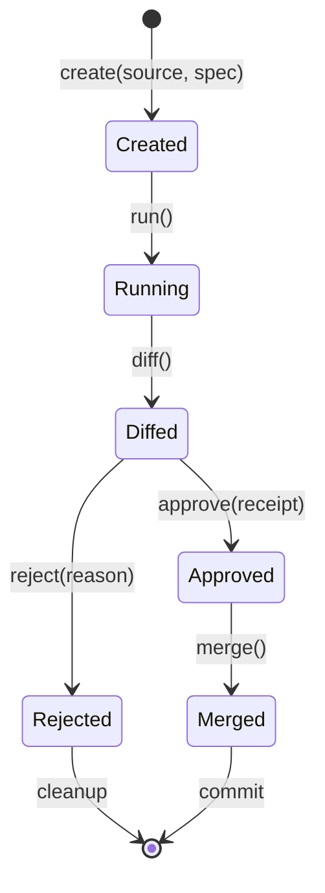

# C25 — Hole Substrate & Verifiable Execution

**Status.** Scaffolded; detail pending. **Parent:** Master Design Document index.

## Purpose

Hole isolation, diff, approve, merge, and Merkle guards as the execution substrate.

## Subcategories (broad topics)

- C25.1 Hole lifecycle (create/run/diff/approve/merge)
- C25.2 Merkle source/hole roots and guards
- C25.3 Property tests (hole/merge/Merkle)
- C25.4 Approval gating and seatbelt confinement
- C25.5 Subagent loops (depth/budget caps, fan-in)
- C25.6 Self-modification via holes (self-improving harness C13.4)

## Open questions / gaps

- Deepen with current holes implementation details.

## Formal Hole Semantics (Separation Logic)

### Hole as Separation Logic Frame

A **hole** $H$ is a triple $(S, H, M)$ where:

- $S$ = Source state (pre-condition)
- $H$ = Hole state (mutable frame)
- $M$ = Merkle guards $(root_S, root_H)$

**Frame rule**: $\{P\} C \{Q\} \implies \{P * R\} C \{Q * R\}$ where $R$ is the hole frame.

### Hole Lifecycle as State Machine



**Invariants**:

- `Created`: $H = \emptyset$, $root_H = root_S$
- `Running`: $H$ evolves, $root_H$ updated incrementally
- `Diffed`: $diff = H \setminus S$, $root_{diff}$ computed
- `Approved`: $receipt$ binds $diff$ to approver
- `Merged`: $S' = S \oplus diff$, $root_{S'} = root_H$

### Merkle Guards

```rust
struct MerkleGuards {
    source_root: Hash,      // Hash of source state at creation
    hole_root: Hash,        // Hash of hole state (updated incrementally)
    diff_root: Option<Hash>, // Hash of diff (computed at diff time)
}

impl MerkleGuards {
    fn verify_merge(&self, merged_state: &State) -> bool {
        let expected = self.source_root.merge(self.diff_root?);
        Hash::of(merged_state) == expected
    }
}
```

**Verification**: `merge` fails if `verify_merge` returns false.

### Seatbelt Confinement

```rust
// Seatbelt profile for hole execution
const HOLE_SEATBELT: &str = r#"
(version 1)
(deny default)
(allow file-read* (regex #"^/tmp/hole_[a-f0-9]+/.*"))
(allow file-write* (regex #"^/tmp/hole_[a-f0-9]+/.*"))
(allow process-exec (regex #"^/usr/bin/(git|cargo|rustc|python3)$"))
(deny network*)
(deny sysctl*)
"#;

fn run_in_hole(hole: &mut Hole, cmd: Command) -> Result<Output> {
    let sandbox = Seatbelt::new(HOLE_SEATBELT)
        .with_temp_dir(hole.temp_dir())
        .with_resource_limits(ResourceLimits {
            memory_mb: 512,
            cpu_time_sec: 30,
            file_size_mb: 100,
        });
    sandbox.exec(cmd)
}
```

### Subagent Loops (Depth/Budget Caps)

```rust
struct SubagentLoop {
    max_depth: u32,           // Default: 5
    max_budget_ms: u64,       // Default: 30,000
    fan_in_limit: u32,        // Default: 4
    circuit_breaker: CircuitBreaker,
}

impl SubagentLoop {
    fn spawn(&self, parent: &Agent, task: Task) -> Result<SubagentResult> {
        let mut depth = 0;
        let mut budget = self.max_budget_ms;
        let mut results = Vec::new();

        while depth < self.max_depth && budget > 0 {
            let child = Agent::spawn_child(parent, task)?;
            let start = Instant::now();

            let result = child.execute(task)?;
            budget -= start.elapsed().as_millis() as u64;

            results.push(result);

            if results.len() >= self.fan_in_limit as usize {
                break;
            }

            // Next task from fan-in
            task = self.schedule_next(results.clone())?;
            depth += 1;
        }

        Ok(SubagentResult { results, depth, budget_used: self.max_budget_ms - budget })
    }
}
```

### Property Tests (QuickCheck)

```rust
#[quickcheck]
fn hole_merge_preserves_source(source: State, hole: Hole, approval: ApprovalReceipt) -> TestResult {
    let mut hole = hole;
    hole.approve(approval)?;
    let merged = hole.merge()?;

    TestResult::from_bool(
        // Source state unchanged
        source == merged.source_state &&
        // Merkle root matches
        MerkleRoot::of(&merged) == approval.merkle_root &&
        // No data loss
        merged.receipt_chain.verify()
    )
}

#[quickcheck]
fn hole_isolation_no_leak(hole: Hole, external_state: State) -> TestResult {
    // Run hole with external state accessible
    let result = hole.run_with_context(external_state)?;

    TestResult::from_bool(
        // External state unchanged
        external_state == result.context_after &&
        // No capabilities leaked
        !result.capabilities_leaked
    )
}

#[quickcheck]
fn subagent_depth_cap_enforced(max_depth: u32) -> TestResult {
    let loop = SubagentLoop { max_depth, ..Default::default() };
    let deep_task = Task::recursive(max_depth + 10);

    let result = loop.spawn(&Agent::root(), deep_task)?;

    TestResult::from_bool(result.depth <= max_depth)
}
```

### Self-Modification via Holes (C13.4)

```rust
fn propose_self_modification(
    agent: &Agent,
    mutation: Mutation
) -> Result<ModificationProposal> {
    // 1. Create hole for mutation
    let mut hole = Hole::create(
        source: agent.config.clone(),
        spec: MutationSpec { mutation },
    )?;

    // 2. Run mutation in isolated hole
    hole.run()?;

    // 3. Verify against judges
    let judge_results = run_judges(&hole.state)?;

    // 4. Check guardrails
    check_guardrails(&judge_results)?;

    // 5. Create proposal with receipt
    Ok(ModificationProposal {
        mutation,
        judge_results,
        receipt: MerkleReceipt::new(&hole),
        human_approval_required: mutation.crosses_lane_boundary(),
    })
}
```

---

## Contributor Deepening — Muse (2026-10-26)

### C25.7 Merge atomicity (depth: the state machine skips the failure state)

The lifecycle diagram (Created → Running → Diffed → Approved/Rejected → Merged) has no failure states: merge() is drawn as infallible, but C22.3 documents Merkle-mismatch rejection and C25 property tests assert merge CAN fail. Frozen completion [PROPOSED — states are my proposal; C22.3 + the property tests are the authority]:

- Add MergeFailed(root_expected, root_actual, diff_hash) as a terminal state from Approved: merge attempted, guard rejected, both source and hole preserved (C22.3 runbook entry point).
- Add HoleCorrupt(detected_at, last_good_root) reachable from ANY state via background integrity scan: seatbelt violation, temp-dir loss, or guard mismatch outside merge. Corrupt holes are quarantined, never auto-retried — retry of a corrupt hole is a repudiation vector (C16 STRIDE).
- The verify_merge function above computes source_root.merge(diff_root?) with ? on diff_root — but the Diffed invariant guarantees root_diff computed. If diff_root is None at merge time, the hole skipped the Diffed state: that is a lifecycle violation, and verify_merge must FAIL CLOSED (return false) rather than propagate None. Merge without diff is not a merge, it is a violation.

### C25.8 Seatbelt profile vs hole temp-dirs (depth: the profile hardcodes what the code generates)

The HOLE_SEATBELT profile allows ^/tmp/hole_[a-f0-9]+/.* — but run_in_hole takes hole.temp_dir() from code. Frozen binding rule [PROPOSED — rule is my proposal]:

1. The temp-dir pattern is a SINGLE constant shared by the profile generator and temp_dir(): profile text is generated from the constant, never hand-written. A hand-written profile + code-generated path WILL drift (cf. C19.8 schema drift — same failure class).
2. The (allow process-exec (regex ...)) list (git/cargo/rustc/python3) is a capability grant per C29 effect system: each binary maps to a tool effect level, and hole execution of a binary above the lane allowlist effect is denied even inside the seatbelt. Seatbelt confines the OS; the effect system confines the intent. Document both layers here, not just the OS one.
3. (deny network*) is absolute in the profile — but C26 ingest and C18 MCP presets may need network inside a hole (ingest-then-verify pattern). If any approved workflow needs network-in-hole, it requires a separate HOLE_SEATBELT_NET profile + explicit approval + receipt stating the egress endpoints. No silent profile widening: the default stays deny.

What was NOT checked here: current holes implementation (cited as TBD above); whether temp_dir() format matches the profile regex today (verify at implementation).

## Open questions / gaps

- Deepen with current holes implementation details.
