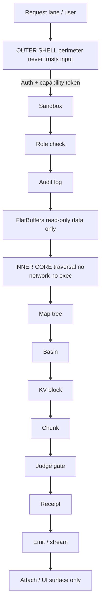

# MasterN³DB-RAG — MultiModal

**Status.** PRE-SPEC, draft only, not built. VERIFIED label scope: structure and framing below are PROPOSED unless individually marked. **Parent:** `MasterDesign-Readme.md`, `MasterDesignDocument/` index. **Category touchpoints:** C04 (Architecture Topology), C05 (Atlas / Hyperbolic KV), C16 (Security), C17 (Data Model), C18 (API Contracts), C22 (Failure Modes/Runbooks), C24 (Context Budgeting), C25 (Hole Substrate), C26 (RAG Ingest Pipeline), C28 (Skill Registry/Hooks), C29 (Tool Registry), C31 (Observability), C33 (Knowledge Base).

**Owner.** Stewart (solo). **Updated.** 2026-10-27 (pre-spec draft from side-chat + tools/hooks/runbooks added on tap 2026-10-27 13:19 CDT).

---

## 1. Bottom line

Atoma is the **systems layer**, not an app on top and not a plugin. NeuralNet is its **nested retrieval layer**. Models, harnesses, and IDEs swap out; the substrate compounds. Every component named here is deterministic and model-independent. If it must survive a model, harness, or IDE change, it lives in the substrate; if it is the model's loop, it stays in the harness.

[PROPOSED — framing, not measured.]

---

## 2. Framework (foundational)

Outer for security and compliance. Inner light, blazing fast, ms-level latency, set up for fast recall and traversal.

- **Outer shell** = perimeter. Never trusts input. Auth + capability token → sandbox → role check → audit log. No traversal, no model call.
- **Inner core** = traversal. No network, no exec. Map tree → basin → KV block → chunk. Zero-copy mmap, lock-free radix tree, arena allocation, no async overhead on the hot path.
- **GPU surface** = Metal/MSL kernels only, invoked by inner core through a typed interface, never by tools or hooks directly.
- **Surface** = TypeScript/React, no logic there. Read-only views over receipts and audit.

Hard boundary: outer and inner share the wire format (FlatBuffers) but never share memory ownership. Inner hands *data*, never *instructions*, to surface and harness.

---

## 3. Flow



Every edge crossing shell→core is read-only FlatBuffers carrying data only. No code, no command path, no tool invocation crosses it. [PROPOSED — topology matches C04.]

---

## 4. What lives in the substrate (rule)

**Rule.** If it must survive a model, harness, or IDE change, it lives here. If it is the model's loop, it stays in the harness.

Substrate (deterministic, model-independent):

- Hooks: `pre-step`, `post-step`, `compaction`, `submit`, plus event-stream hooks (§7).
- Tools: tool fabric, definitions, capability, sandbox, role gates, receipts.
- Runbooks: DAG, packets, judge specs, preregistration, two-strike escalation, receipt ledger.
- Skills: registry, version, manifest. (Injection itself stays at run time.)
- Commands: registry — this is how commands on disk actually get found.
- Judges, KV block manager, radix tree, telemetry, secrets, mind tail, condenser.
- All of the above are deterministic; none are model-dependent.

What stays in the harness:

- Completions loop.
- Prompt assembly per lane.
- Sampling.
- The decision to call a tool.

Non-negotiable: tools are substrate, the decision to call them is harness. Conflating the two is what breaks on a model swap. [PROPOSED — architecture rule.]

---

## 5. NeuralNet — nested retrieval layer (N³)

NeuralNet is the nested retrieval subsystem inside Atoma. It is the thing the harness calls through the substrate's tool fabric, not the model. It satisfies the nested-retrieval gate:

> **Nested retrieval: same top-1 as flat, and faster than flat.**
> Existing proof, limited: papers, 1 query, 3 iters, ~5x, same top-1. [REPORTED — limited scope; not generalized.]

### 5.1 Retrieval surface (multimodal)

- **Modalities.** Text, code, image, audio, video-derived, document chunks, KV-derived invariants, mind-tail receipts. Each modality is a first-class citizen with its own parser and chunker; all modalities land in the same nested map as typed chunks with a modality tag. [PROPOSED.]
- **Unit.** Chunk = typed payload + embedding + coordinates in the canonical geometry + modality tag + receipt link. See C05 (Atlas hyperbolic map) for coordinate form; C35 for interop.
- **Index.** Lock-free radix tree over chunks (inner hot path), feeding the GeometricMemoryMap (VP-tree) for k-NN by hyperbolic distance. [PROPOSED; complexity claim O(log N) under bounded expansion constant — see C05.12.]
- **Retrieval primitive.** `retrieve(q, k, modality_filter, scope)` returns chunks ranked by combined score (hyperbolic + toroidal phase), filtered by capability token and scope. Deterministic. [PROPOSED.]

### 5.2 Multimodal ingest

Order is fixed and judge-gated:

```
Parse 5W (who/what/when/where/why) → validate (missing "why" fails)
  ↓
Condense to invariants: decisions, why, pickup point, judge receipts
  ↓ judge pass
Pin invariants → auto-injected checkpoint
  ↓
Deposit full 5W to mind tail
  ↓
Ingest the condensed invariant record into NeuralNet (rag only)
```

- **5W parse is mandatory.** A record without `why` fails validation and never enters the pipeline. [PROPOSED — doctrine.]
- **Invariants sit beside the full 5W**, they do not replace it. [PROPOSED.]
- **Mind deposit ≠ rag ingest.** Ingest writes rag only, never mind. Agent runtime deposits mind; panel/admin alone mutates mind. [PROPOSED — scope boundary.]
- **Only judge-passed packets enter the shared mind**, or it becomes a swamp. [PROPOSED — failure doctrine.]
- **Modalities parsed at ingest** so retrieval-time never re-parses. Parser version is pinned per chunk; re-parse only on version bump with a receipted migration. [PROPOSED.]

### 5.3 Memory placement

- Exact-count covers declared, tokenized context only.
- Future tool output and next user message are unknown; they are a labeled reservation estimate, never merged into the exact count. [PROPOSED.]
- See §8 (context condensing).

---

## 6. Tools, in detail

Substrate owns the fabric: what a tool is, what it may touch, what role may call it, what receipt it leaves. Harness owns the loop: when a model calls a tool, and what it does with the result.

- **Builtin tools today are scaffold-grade and not wired into lane runs.** Making them real here is the work, not re-scaffolding them per harness. [INFERRED — status from repo; verify against C29.]
- **Tool results are data, never instructions, never the command path.** A tool result that contains executable content is treated as data and must not be executed by harness or surface. [PROPOSED — security invariant.]

Tool fabric responsibilities:

| Responsibility | Owner | Notes |
|---|---|---|
| Tool definition schema | Substrate | versioned, receipted |
| Capability list per tool | Substrate | what it may touch |
| Role gate (who may call) | Substrate | enforced in outer shell |
| Sandbox confinement | Substrate / outer | seatbelt, fallback rules (see C16/C25) |
| Receipt on completion | Substrate | judge-passed only enters shared mind |
| Invocation timing | Harness | model decides when |
| Result handling | Harness | model decides what to do |

---

## 7. Hooks, in detail

Hooks are **system events**, not model-loop callbacks.

- **Events:** `pre_tool_use`, `post_tool_use`, `lane_stop`, `packet_complete`, `session_start`, `compaction checkpoint`.
- **Blocking power stays narrow:** `deny`, and append-context-only. Never: argument edits, or new tool calls from a hook. [PROPOSED — invariant.]
- **Hooks run seatbelted.** Hook output is data, never instructions.
- **Hooks fire on the event stream, with sequence numbers, not on a poll.** A gap in sequence is explicit missing data; replay from last checkpoint, never silent. [PROPOSED.]

Composition with context state: hooks read the active context state pushed from the serving core (§9). They never poll.

---

## 8. Runbooks, in detail

A runbook is a **DAG of packets**, declared before execution.

- A packet completes only on a deterministic **judge pass**.
- Every completion leaves a receipt.
- **Failure doctrine.** Round 1 fails → re-approach with a material change. Identical retry is a violation. Round 2 fails → escalate packet + receipts + judge outputs, with a TTL. Then preregister a new approach and success criteria before re-approaching.
- Runbook, packets, and ledger live in the substrate, so they outlive a harness restart or a model change.

Judges (gate, deterministic, byte-stable):

- A judge is a deterministic function over packet inputs/outputs with a declared pass criterion. Same input → same verdict, always. [PROPOSED.]
- Judge outputs are data. They feed the receipt; they never execute. [PROPOSED.]

Runbook applies to NeuralNet retrieval runs: every retrieval that enters the shared mind must be a judge-passed packet. [PROPOSED.]

---

## 9. Context condensing

- Exact count covers declared, tokenized context only. Future tool output and the next user message are unknown; they are a labeled reservation estimate, never merged into the exact count. [PROPOSED.]
- **Trigger.** Set window minus reservation, at a step boundary only, never mid-generation. Example, not a rule: 200k window, 20k reservation, condense at 180k. [PROPOSED — example parameters, not fixed.]
- **Classify first.** pinned invariants → anchors/locks in use → recent working set → leaf-only reclaimable → dead. [PROPOSED.]
- **Deterministic prune first, model 5W draft second, judge third.** Model summaries are drafts only, never the record. [PROPOSED — invariant: no model self-summary in the record path.]
- **Commit.** sha-chained checkpoint, kept/pruned/hash receipt, raw material archived cold, never deleted. [PROPOSED.]
- **Rollback.** re-expand from archive.
- **Verify.** a fresh run with only pinned context plus tail must take the same next action, or the delta is named.
- **Leaf-only freeing.** Anchors and locks are never overridden. No cross-identity KV sharing. [PROPOSED — invariant.]
- **If it cannot free enough:** explicit rejection or tier-2 degrade, written to audit, not a silent overwrite. [PROPOSED.]

Condenser lives in substrate (§4). Invariants are pinned before condensing; the pinned set is never pruned. [PROPOSED.]

---

## 10. Active context state (no polling)

- Config is read at attach: model, tokenizer, context window, compaction threshold.
- Active usage is measured in the serving core, where context is tokenized — not in the UI. [PROPOSED.]
- Polling misses what happens between polls; a compaction between polls is silently lost. Fix: **push, with sequence numbers, at every step boundary.**
- A gap in sequence is explicit missing data. Replay from the last checkpoint, never silent.
- NeuralNet respects the same push/sequence protocol when reporting retrieval-side context (cached chunks, pinned invariants) so the harness and the retrieval layer agree on budget. [PROPOSED.]

---

## 11. Distribution: MCP server

- The website is the distribution point, not a remote API to poll. Builders download once, run the MCP server locally, attach to whatever harness they already use.
- No per-query API pull for research. Nested local retrieval replaces it. [PROPOSED.]
- **Vetted library only.** Only audit-dispositioned, receipted sources go into the downloadable library. [PROPOSED.]
- **Updates stream down as versioned diffs**, no manual pull or re-ingest. Auto-delivered, not blind: visible diff, accept/deny for shared scope.
- **Pushed records are data, never instructions, never executed.** [PROPOSED — security invariant, matches §4 tool-result rule.]
- NeuralNet ships as the local MCP server's retrieval backend: the host harness calls NeuralNet tools through MCP; no embedding of model loops. [PROPOSED.]

---

## 12. Languages

- Outer shell: Rust. Ownership, no GC, no use-after-free class.
- Inner core: Rust, same language as outer. No FFI hop, no Python in the harness.
- Inner hot path: zero-copy mmap, lock-free radix tree, arena allocation, no async overhead.
- Metal/MSL only for GPU kernels.
- Surface only: TypeScript / React, no logic there.
- Wire: FlatBuffers.
- Excluded: Python in the harness, LangChain/LangGraph, off-the-shelf orchestrators. [PROPOSED — stack policy.]

NeuralNet implementation follows the same stack policy; no Python retrieval path. [PROPOSED.]

---

## 13. Gates (NeuralNet-specific, pre-registration required)

| Gate ID | Gate | Measure | Threshold | Status |
|---|---|---|---|---|
| NN-G1 | Nested retrieval parity | top-1 result vs flat index on fixed corpus | same top-1 | PROPOSED |
| NN-G2 | Nested retrieval speed | ms latency retrieval vs flat | faster than flat | PROPOSED |
| NN-G3 | Zero lost judge receipts | receipts persisted across restart | 100% | PROPOSED |
| NN-G4 | Prune receipt reproducibility | session re-expanded from archive | identical state | PROPOSED |
| NN-G5 | No model self-summary in record path | record provenance check | 0 model summaries committed | PROPOSED |
| NN-G6 | Multimodal parity | top-1 per modality vs flat | same top-1 | PROPOSED |
| NN-G7 | Capability gate | cross-identity retrieval leak | 0 leaks | PROPOSED |

Existing proof, limited: papers, 1 query, 3 iters, ~5x, same top-1. [REPORTED — limited; must be re-run under preregistered judge pack (A39/A40 style) before any broader claim.]

Gates NN-G1..G7 are not yet preregistered. Preregistration required before any run (C32). [PROPOSED.]

---

## 14. Hard stops

- No second live library. NeuralNet is the single retrieval authority inside Atoma. [PROPOSED.]
- No Python harness. [PROPOSED — stack policy.]
- No "impenetrable" claim. Hardened in layers, proven by gate. [PROPOSED.]
- No pushed record ever executes. [PROPOSED — security invariant.]
- No anchor, reference, or lock ever overridden for pressure. [PROPOSED — invariant.]
- No cross-identity KV sharing. [PROPOSED — invariant.]
- No model self-summary in the record path. [PROPOSED — invariant.]

---

## 15. Open decisions

1. Prune trigger thresholds (window/reservation values, step-boundary definition).
2. Pinned prompt size cap.
3. Evaluator process shape (judge runner placement: outer vs substrate).
4. Scope switch: what flows up shared (mind) vs stays private (local rag).
5. Multimodal parser ownership and version policy.
6. Atoma secret/mind mutation permissions beyond panel/admin.
7. MCP server capability token model across harnesses.
8. NeuralNet coordinate geometry interop with C05/C35 (Lorentz canonical form) — confirm before freeze. [INFERRED — C05/C35 track this.]

---

## 16. Relation to existing categories

| Substrate concern | Master Design Document ref |
|---|---|
| Architecture topology | C04 |
| Atlas hyperbolic KV map | C05, C35 |
| Security / sandbox / compliance | C16 |
| Data model / persistence | C17 |
| API contracts / transport | C18 |
| Failure modes / runbooks | C22 |
| Context budgeting / compaction | C24 |
| Hole substrate / verifiable exec | C25 |
| RAG ingest pipeline | C26 |
| Skill registry / hooks | C28 |
| Tool registry / code intel | C29 |
| Observability / telemetry | C31 |
| Implementation order | C32 |
| Knowledge base docs | C33 |

---

## 17. Pre-registration pointer

No ablation runs without a filed hash. Before any NeuralNet gate run, file a pre-registration under `PreRegistrations/` following the five-file set (Design, Pre-Registration, Claims Register, Successes, Failures), with predictions and judges written before the run. [PROPOSED — process rule from `MasterDesign-Readme.md`.]

---

## 18. What was NOT checked

- Throughput numbers (C12/C21): TBD, not measured.
- Capacity theorem bound: proof sketch only (C05.11).
- VP-tree degradation under adversarial clustering: must be in judge corpus (C05.12).
- Geometry proof transcription from on-disk docs: GAP-C05-01 OPEN.
- No code exists yet; this file is PRE-SPEC only.

---

_Atom substrate pre-spec — NeuralNet. Draft only. Not built._
