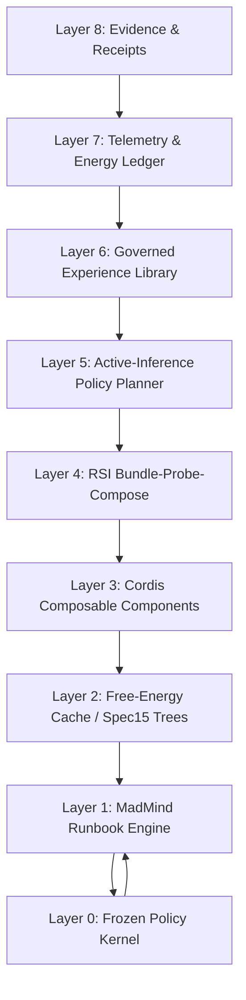

# Research-Grade Agentic Harness — Design Spec

**Subject.** A research-grade agentic harness that is plan-driven and judge-gated (MadMind), recursively self-improving (Harness²), built on spatiotemporally composable runtime components (Cordis), and bound by **active inference / free-energy minimization** and the **thermodynamic Landauer tax** (thermodynamic cost minimization).

**Status.** PROPOSED design scaffold. No code written in this pass. Every performance number below is PROPOSED until an ablation hash is filed and a receipt is produced. Every empirical claim is labeled (§7).

**Date.** 2026-10-27.

**Parent inputs (VERIFIED in this workspace).**

- `MetaSuperIntelligenceLabs-Global-HackAthon-Design/` (project root — this repository).
- MadMind spec set at `~/Desktop/AtomaApp/Harnesses-2026-10-23/madmind/{specs,core}`; specs 15/16/17 + sampling-policy draft.
- Harness² clone + audits at `~/Desktop/AtomaApp/Harnesses-2026-10-23/{harness2,audits}` (arXiv:2610.14224).
- Cordis spatiotemporal composability preprint extract (`preprints__…2608.25512__SpatiotemporalComposability-DeepSeek-2608-25512.md`), DeepSeek/PKU.
- `Ai Research and Preprint Vault/preprints/*Harness*.md` (five agentic-harness preprints, abstract records).
- Monster-hybrid-server Spec 13/14 reference (KV/caching, thermodynamic dissipation) cited inside Spec 15.

---

## 0. Claim labels (per §7)

Every claim in this document carries one of:

- **VERIFIED** — measured or read from source in this workspace.
- **REPORTED** — a source says so; unchecked here.
- **INFERRED** — reasoned from evidence; stated where the evidence ends.
- **PROPOSED** — a plan, not a fact.

Corrections are appended, never silently rewritten.

---

## 1. Executive summary

We propose an agentic harness defined by four non-negotiable principles:

1. **Plan before execution** (MadMind doctrine). Intent exists as data — a DAG of packets — before any token is generated; completion is deterministic-judge gated and receipted. No self-grading.
2. **Cache and context obey free-energy dynamics** (Spec 15). Residency, dissipation, and prefill are governed by an audit of declared context; there is no geometric fantasy of infinite reuse. Sharing is exact-prefix, no patch-up (named loss, §15.3).
3. **Recursive self-improvement is structural** (Harness²). The harness edits itself through Propose–Probe–Compose (PPC), with harnessing-level experience retention, but only inside a frozen safety kernel and only with deterministic judges supreme.
4. **All change is priced by the Landauer tax** (thermodynamic minimization). Every bit erased, every context block evicted, every probe rollout costs at least kT ln 2 of free energy and is charged to an energy budget. Improvements that cost more Landauer free energy than they save are refused.

**Core thesis (PROPOSED).** Treat the harness as an active-inference agent whose **expected free energy (EFE)** over policies (plans + harness configurations) is minimized subject to a hard **Landauer energy budget**. Recursive self-improvement (PPC) is not an unbounded search over harness strings; it is an adaptive re-parameterization that lowers EFE while paying a Landauer-priced energy ledger. The harness is therefore an open dissipative system: it maintains low internal free energy by exporting waste (receipts, discarded context, failed probes) as heat-ish cost (tokens, compute, bits erased), and it refuses to grow when the second law (Landauer bound) would be violated.

---

## 2. Inputs audited and what transfers (VERIFIED/REPORTED/INFERRED)

| Source                                                         | What it is (verified)                                                                                                                                               | What transfers into this design                                                                                                                                          |
| -------------------------------------------------------------- | ------------------------------------------------------------------------------------------------------------------------------------------------------------------- | ------------------------------------------------------------------------------------------------------------------------------------------------------------------------ |
| **MadMind** Spec 15 (Meta Automaton)                           | Two-tree (radix + plan) cache dynamics; five binding rules (safe reclamation, cache identity, coverage scope, deterministic decay, pressure); receipted plan state. | Layer 1/2: plan-as-data, deterministic decay, anchor rationing, coverage exact/estimate split, all become thermodynamic accounting primitives.                           |
| **MadMind** Spec 16 (Agentic Harness)                          | Plan-driven, judge-gated, Erlang-shaped supervision, two-strike escalation, tactical levels T0–T4, Rust-only backend.                                               | Layer 1/4: failure doctrine, tactical cost budgets, typed tool fabric, receipt truth.                                                                                    |
| **Harness²** (Google Research, arXiv:2610.14224)               | Recursive harnessing: Propose–Probe–Compose, eight editable components, hidden-score hygiene, experience library; permissive benchmark containment.                 | Layer 4: PPC machinery — but with MadMind judges supreme, kernel-frozen policy, Landauer-priced probes, and production containment.                                      |
| **Cordis** (Shi et al., DeepSeek/PKU; arXiv:2608.25512)        | Revertible effects, reactive coeffects, unified context type, observational equivalence, dynamic component composition, hot module replacement.                     | Layer 3: harness components become reversible effects/coeffects with inverse held by runtime; edits revert cleanly; components compose with spatiotemporal independence. |
| **Agentic Harness Engineering** (Lin et al., arXiv:2604.25850) | File-level editable components; trajectory distillation into drill-down evidence; self-declared prediction → verified outcome as falsifiable contracts.             | Evidence discipline: every harness edit declares prediction and price; audit compares to next-round outcomes.                                                            |
| **GenMem** (Jiang et al., arXiv:2609.34633)                    | Generative symbolic memory (SIDs) addressing; addressing invariance under payload rewrite.                                                                          | Experience library identity: SIDs as stable addresses for reusable harness lessons; memory evolves without breaking addressing.                                          |
| **Harness as a Language** (Li et al., arXiv:2609.26891)        | Minimal agent loop with recursive `invoke`; all visible state is a variable.                                                                                        | Minimalist inner loop: keep the execution substrate tiny; recursion is a primitive, not a framework.                                                                     |
| **HEAR Protocol** (Zhao et al., arXiv:2610.06597)              | Bidirectional harness–engine pairing; workflow intent ↔ runtime state; cache-aware coordination; workload-aware mode selection.                                     | HEAR-style coordination between harness audit and serving engine: declared plan → engine prefill/eviction. Already native in MadMind via Spec 15.                        |
| **Harness-the-Memory** (Huang et al., arXiv:2608.15008)        | No single substrate dominates; routing over memory regimes; retrieval can harm action-critical context.                                                             | Memory-substrate routing as a first-class policy subject to thermodynamic cost; avoid gratuitous retrieval.                                                              |

**What is NOT transferred (PROPOSED restriction).**

- Harness²'s judge-free adoption, finals-only pool, and permissive execution posture (sandbox bypass, unrestricted network) — **rejected** for production (audit §"What not to copy").
- Cordis's effect/coeffect formalism does not by itself enforce thermodynamic budgets; we graft budgets on as a first-class coeffect.
- Active inference is used as the _selection_ and _attention_ mathematics, not as a claim that the LLM literally computes free energy; the harness computes surrogate F/G from receipts and tokens. **INFERRED**, not measured.

---

## 3. Formal foundations

### 3.1 Notation

- \(s\) — hidden task/world state.
- \(o\) — observation (model output, tool output, judge verdict).
- \(\mu\) — internal beliefs (probabilistic) over \(s\).
- \(\pi\) — a policy: an ordered sequence of actions (packet executions, tool calls, RSI edits).
- \(G(\pi) = \mathbb{E}_\pi[\,\text{epistemic value} + \text{pragmatic value}\,]\) — expected free energy (standard active-inference formulation).
- \(F(\mu,o)=\mathbb{D}_{\mathrm{KL}}[\mu(s)\,\|\,\,p(s\mid o)]+\log p(o)\) — variational free energy (VFE) as an energy for belief update (standard).
- \(k_{\mathrm{B}}T\ln 2\) — Landauer energy per erased bit at temperature \(T\).

**VERIFIED (as standard formulas):** Active inference's EFE/G decomposition and VFE are textbook (Friston et al.); values become **PROPOSED** once mapped to tokens/compute here.

### 3.2 Active inference core

We adopt the standard active-inference (AIF) structure:

1. **Generative model** \(p(o,s)\) — task-domain model held by the harness: what a "good packet completion" looks like, priors over task shapes, and the deterministic judge as likelihood source \(p(o\mid s)\).
2. **Recognition/belief update** minimizes VFE \(F\) with respect to \(\mu\) given observation \(o\).
3. **Action selection** minimizes EFE \(G(\pi)\) over candidate policies; EFE decomposes into (a) epistemic value (information gain about task/harness state) and (b) pragmatic value (achieve preferred outcomes, i.e., pass judges).
4. **Precision weighting** acts as temperature: high precision = sharp, deterministic (judges); low precision = exploration.

Applied to harness control, this means:

- **Policies are runbooks + harness edits.** A policy \(\pi\) is a packet DAG (MadMind plan) plus, optionally, a bundle edit sequence (Harness² component deltas).
- **Preference prior** = "judges pass, waste below budget."
- **Epistemic actions** = probes, RECON (`/recon`), measurements. These gather information about task/harness state.
- **Pragmatic actions** = code production, tool calls, merges. These pursue judge pass.
- **Salience** = likelihood of reducing EFE per cost. Probes (T4 `/probe`) are ranked by expected information per Landauer cost (below).

### 3.3 Free energy conservation law (PROPOSED, not measured)

We impose an accounting law across a run:

\[
\Delta \mathcal{F}_{\text{total}} \;=\; \Delta \mathcal{F}_{\text{model}} + \Delta \mathcal{F}_{\text{cache}} + \Delta \mathcal{F}_{\text{evolution}} + \Delta \mathcal{F}_{\text{receipt}} \;\ge\; 0
\]

where each \(\mathcal{F}\) is a **thermodynamic-style free energy** (surrogate, in J-equivalents) of the respective subsystem:

- \(\mathcal{F}_{\text{model}}\): VFE of the belief state (task uncertainty). Falls when observations (judge verdicts, tool outputs) are integrated. This is the value harnessing produces.
- \(\mathcal{F}_{\text{cache}}\): residual free energy of resident KV/cache blocks = unreclaimed non-anchor mass. Falls when coverage improves and anchors release.
- \(\mathcal{F}_{\text{evolution}}\): search cost of RSI: probes, editor sessions, candidate evaluations.
- \(\mathcal{F}_{\text{receipt}}\): durable evidence cost: hashes, persistence.

**Claim (INFERRED).** A run that _reduces task VFE_ while _not increasing_ the other free energies beyond the Landauer budget is a thermodynamically admissible improvement. This is an accounting convention we are introducing; it is not a theorem of thermodynamics applied to computation (actual physical free energy of computation is a deeper claim about the hardware). We label it PROPOSED/INFERRED and never present it as physics-valid (see §7 and §16 on overclaim risk).

**Binding rule.** Every change must be accompanied by a **free-energy ledger** entry (receipt), or it is void (same discipline as MadMind receipts).

### 3.4 Landauer tax and thermodynamic cost minimization

**Landauer's principle (REPORTED, standard physics):** erasing one bit of information in a system at temperature \(T\) requires at least \(k_{\mathrm{B}}T\ln 2\) of work dissipated as heat. We use it as a **lower bound and accounting unit**, not as a claim that the LLM erases bits at that bound.

We define a **thermodynamic cost unit** for harness operations:

1. **Bit-erasure cost.** Any operation that _discards_ information (cache eviction with refcount→0, context summarization that drops detail, compaction that folds messages, garbage collection, dropping a failed probe's context) incurs

   \[
   E_{\text{erase}}(n_{\text{bits}}) \;\ge\; n_{\text{bits}}\; k_{\mathrm{B}}T \ln 2.
   \]

   In practice we price with a **Landauer coefficient** \(\lambda_L\) (J/bit), calibrated against measured hardware (PROPOSED until measured; see §8 calibration).

2. **Work cost.** Any operation that _transforms_ information (prefill, inference, retrieval) incurs an energy cost measured in actual device joules (or a token-energy surrogate when device telemetry is unavailable).

3. **Thermodynamic minimum for a task.** A task with Kolmogorov-complexity-ish information content \(I\) bits requires at least \(I\,k_{\mathrm{B}}T\ln 2\) of erased work plus transform work. We never claim to reach it; we track **distance to it** as a metric.

**Cost-minimization objective (PROPOSED):**

\[
\min_{\pi,\,h}\; \Big[\,\alpha\,\mathcal{F}_{\text{model}}(\pi,h)

- \beta\,E_{\text{transform}}(\pi,h)
- \gamma\,E_{\text{erase}}(\pi,h)
- \delta\,E_{\text{evolution}}(\pi,h)\Big]
  \]

subject to:

- deterministic judges pass (hard constraint),
- Landauer budget \(B_L\) not exceeded,
- coverage \(C \ge C_{\min}\),
- no policy-kernel mutation (frozen).

Coefficients \(\alpha..\delta\) are design-time knobs; PROPOSED defaults: \(\alpha=4,\beta=1,\gamma=1,\delta=2\) (premium on belief reduction and search restraint). To be calibrated (§12).

### 3.5 Precision as thermodynamic resource (INFERRED)

In AIF, precision weights the balance between prior and likelihood. We map:

- **High precision (cold/deterministic)** = low thermal noise = expensive in Landauer terms (sharp discriminators, judges, exact hashes). Used for completion gates.
- **Low precision (warm/exploratory)** = cheap entropy; used for proposals and probes.

This justifies T4 `/probe` ranking: an exploration action is worth doing only if its expected EFE reduction exceeds its precision/Landauer cost.

---

## 4. Architecture (layers)

**Layer 0 — Frozen Policy Kernel (FPK).** Immutable at runtime and untouchable by any RSI edit, any component, any proposal, any harness editor. Contains: deterministic judges, safety policy, egress rules, secrets handling, test-split hygiene, receipt rules, promotion gates, Landauer budget ceilings, judge registries. Exactly the "frozen kernel" the Harness² audit demands. **No harness edit, proposal, or reflective step may touch Layer 0. Violations are kernel-level refusals, receipted and escalated.**

**Layer 1 — MadMind Runbook Engine.** Packet DAG, judge runner, supervisor (Erlang shape), restart groups, two-strike escalation, tactical levels. Durable state = plan tree + receipt log; no essential state in context windows.

**Layer 2 — Free-Energy Cache (Spec 15).** Radix + plan trees, fixed-point deterministic decay, anchors with rationing, coverage exact over declared (tokenized) context only, pressure rejection beyond bound. Recast as _energy accounting_: anchored blocks carry energy debt; decay is dissipation; sweeps reclaim lowest mass under pressure.

**Layer 3 — Cordis Components.** Every harness feature (memory adapter, tool, skill, subagent, plugin) is a _component_ with revertible effects and reactive coeffects. Unified context type; effects carry inverses held by runtime; coeffect changes drive activation/deactivation. Hot module replacement allowed only within a sandbox and only after re-validation. This makes RSI edits _reversible by construction_ (temporal composability).

**Layer 4 — RSI: Bundle + Probe + Governed Library.** Harness² PPC adapted. Editable harness surface becomes a **MadMind Bundle**: a fingerprinted, versioned, diffable object over eight components (system prompt, guardrails _as guidance only_, memory, tool guidance, subagents, skills, scripts, plugins) **minus** Layer 0. Candidate bundles are proposed (INV/DOM scope), probed in isolated worktrees/lane VMs, composed with KEEP_BASE as a first-class outcome, selected blind-at-`k>1`, reflected into a governed library. **Judges are supreme and available as completion gates** (this deviates from Harness²'s judge-free adoption — a deliberate, stated deviation; see §6).

**Layer 5 — Active-Inference Policy Planner (AIPP).** Sits above the runbook. Generates candidate policies (plan variants + optional bundle deltas) ranked by EFE \(G\), filtered by Landauer budget and precision tier. Interacts with Layer 4 RSI: RSI supplies candidate _harness_ variants; AIPP chooses which to _execute_ based on EFE.

**Layer 6 — Governed Experience Library.** Harness² library shape + GenMem addressing invariance: entries addressed by stable symbolic IDs (SIDs); payload evolves, address fixed. Promotion gated by receipt evidence (MadMind audit rule: reflection may nominate; it may not promote). Contains: adopted bundles, evidence-supported lessons, falsified hypotheses (struck but retained as record — T4 doctrine).

**Layer 7 — Telemetry & Energy Ledger.** Every step emits receipts: cache coverage (exact + estimate), judge verdicts, token/waste figures, validation sampling mode/rate, Landauer cost (erase bits, Joules surrogate). Energy ledger feeds Layer 5 ranking and Layer 6 promotion.

**Layer 8 — Evidence Surface.** Docs, proofs, whitepaper generated from receipts, not memory. (MadMind Phase 3 gate.)

---

## 5. Free-energy cache dynamics (active inference over residency)

### 5.1 Recasting Spec 15 as active inference

Spec 15 audit asks: _does the cache hold the context the next turns need?_ We recast:

- The cache is the harness's **posterior over context residency** \(\mu(c)\). Covered blocks are high-precision beliefs; decay raises uncertainty.
- Decay leaks uncertainty mass according to Plan-coverage. This is exactly precision-weighted forgetting: plan-covered precision → 0 leak (frozen prior); off-plan → fast decay; pressure → global precision degradation.
- **Predictive prefill** = an epistemic act: the audit's required-but-absent blocks are prefilled into idle (tool-wait) windows, reducing expected free energy of future turns.

### 5.2 Free-energy accounting for cache

Define for resident block \(b\):

\[
\mathcal{F}_{\text{cache}}(b)=m_b \cdot (1-\chi_b) + \kappa \cdot \ell_b
\]

where \(m_b\) = mass (fixed-point Q1.31), \(\chi_b \in \{0,1\}\) = plan-covered flag, \(\ell_b\) = lock/anchor hold time. Anchored blocks carry \(\mathcal{F}=0\) while anchored (paid debt) but accrue **anchor debt** \(A_b = m_b\cdot \tau_{\text{remain}}\) priced on release.

Under pressure (bounded admission, Spec 15 Rule 5), the sweeper reclaims refcount-0 lowest-mass blocks; this is a **Landauer event**: reclamation cost \(\ge (m_b\text{-bits}) kT\ln2\) charged to the energy ledger. Priority order (continuations first) protects sunk residency free energy.

### 5.3 The "no patch-up" constraint (Spec 15 §3, named loss)

Hyperbolic graded-reuse (Spec 14) allowed near-miss blocks to patch. Here sharing is **exact-prefix-or-nothing**. This is a hard information-theoretic constraint: a divergent token voids sharing below divergence. We treat this as a **Landauer-relevant loss** — semantic near-misses cost full re-prefill. _INFERRED_ consequence: RSI gains may partly come from restructuring plans to maximize exact-prefix sharing (cache-friendly decomposition). This is a measurable hypothesis (pre-register; see §12).

---

## 6. Recursive self-improvement: Bundle + Probe + Governed (BPG) layer

### 6.1 Deviation statement

Harness² PPC is adopted as the RSI backbone with three **deliberate deviations** recorded (audit §"What not to copy"):

| Harness² default                                            | Our restriction                                            | Reason                                                                                     |
| ----------------------------------------------------------- | ---------------------------------------------------------- | ------------------------------------------------------------------------------------------ |
| Judge-free adoption                                         | **Judges supreme and available as completion gates**       | MadMind founding contract; no behavioral-contrast-as-truth.                                |
| Finals-only pool (no base)                                  | **KEEP_BASE / abstention is first-class outcome**          | Without "none of these," evolution cannot be conservative; Landauer forbids forced change. |
| Guardrails editable                                         | **Guardrails guidance-only; safety in FPK**                | Security boundary cannot be rewritten by an editor.                                        |
| Permissive containment (bypassed sandbox, unrestricted net) | **Kernel-enforced isolation, egress allow-list, receipts** | Production posture.                                                                        |

These deviations are PROPOSED restrictions to be re-examined (Stewart ruling) but are the defaults here.

### 6.2 PPC with Landauer pricing (PROPOSED)

Harness² arithmetic: rolls \(R=4k\), improvement sessions \(P=3k\). We extend:

For a task-level run with recursion budget \(k\):

- **Rollout budget** \(R=4k\) (unchanged).
- **Candidate budget** (INV+DOM) \(2k\) (unchanged).
- **Composition budget** \(k\) (unchanged).
- **Energy budget** (new) \(E_{\text{task}} = B_L^{(\text{task})}\) in Joule-surrogates. No PPC step proceeds if its projected Landauer cost exceeds remaining budget. RSI must **stop or abstain** (KEEP_BASE), not freelance.

**Probe ranking.** A probe is an epistemic action (T4 doctrine). Rank probes by

\[
\mathrm{EIOR}(p) = \frac{\mathbb{E}[\Delta G(p)]}{E_{\text{Landauer}}(p) + \epsilon}
\]

(expected information-on-investment ratio). Proceed only if \(\mathrm{EIOR} > \tau_p\) (threshold; PROPOSED \(\tau_p=1.5\)). This implements "when the best probe costs more than the plan change it could cause, commit."

**Self-declared predictions** (Lin et al.): every proposed edit declares (a) its predicted effect on the next round's outcomes, (b) its Landauer cost, (c) its effect on cache sharing (exact-prefix). These form a falsifiable contract verified against the next round and receipted (decision observability). Persistent mismatches downgrade the proposing lane's precision.

### 6.3 Harmful search: what Landauer prevents

Unbounded RSI explores to lower EFE but erases information (failed probes) at cost. The Landauer budget acts as a **brake**: an improvement that reduces model VFE by \(1\) but costs \(10\) in Landauer free energy is net-negative and is refused _even if judges would pass_. This converts "more recursion = better" into "more recursion = only when thermodynamically profitable," matching the Harness² finding that `k` gains are real but saturating (REPORTED; pay attention to diminishing EIOR).

### 6.4 Meta-level (harnessing-level) RSI

Harness²'s second loop retains adopted bundles + lessons. We add:

- **Second-order active inference:** the evolution policy itself has a posterior; its precision is updated from the record of past PPC steps (did predictions verify? did Landauer budgets hold?). Precision of the meta-policy **never** resets; it is receipted and monotone-informed.
- **Addressing invariance (GenMem):** lessons stored at stable SIDs; content evolves without breaking references. This is essential so accumulated experience compounds (MadMind §3 "hundredth run starts from everything").
- **Falsified hypotheses stay struck** (T4 doctrine). No deletion; record preserved as low-mass, high-accuracy prior (a _negative_ discovery is cheap thermodynamically — its erasure cost paid once).

### 6.5 Abstention (KEEP_BASE) as thermodynamic default

If no candidate pool member beats base _and_ beats the Landauer break-even, the policy selects **KEEP_BASE**. This is mandatory — not optional — because (a) MadMind doctrine, (b) thermodynamics: a zero-change packet has near-zero erasure cost; forcing a change burns Landauer energy for unverified gain. Report abstention rate as a metric (target: honest, not minimized).

---

## 7. Cordis as the substrate for reversible, compositional harness change

### 7.1 Why Cordis here

Harness evolution edits components at runtime. Classical systems either (a) rewrite in place with no guaranteed undo, or (b) coarse-grain restart losing state. Cordis's **revertible effects** guarantee every component's side effects carry an inverse held by the runtime; **reactive coeffects** drive activation/deactivation on context change; **observational equivalence** ensures distinct components interleave without disturbance.

This is the _engineering analogue_ of thermodynamic reversibility: a reversible change has no Landauer tax (erasure cost is zero for a perfectly reversible transformation). We graft this directly:

- **Components whose effects are reversible are exempt from the erasure portion of the Landauer charge** (they cost only transform energy). This creates an incentive for reversible-by-construction harness designs.
- **Irreversible changes (data deletion, context compaction, schema mutation) pay full Landauer.** This makes cost differences visible and steers evolution toward reversible component swaps.

### 7.2 Unified context type (Cordis) + frozen kernel

Cordis unifies effect context and coeffect context into one type. We unify further:

\[
\mathcal{C} = \langle \text{KV blocks}, \text{plan nodes}, \text{bundle versions}, \text{belief } \mu, \text{energy ledger } E \rangle
\]

One context carries cache, plan, harness configuration, belief, and **energy**. Every component's effect and coeffect is mediated through this; FPK (Layer 0) is a coeffect that _cannot be deactivated_ (its coeffect is total and non-reversible — a guardrail as kernel, not as text).

### 7.3 Hot module replacement gates

Cordis supports HMR. We permit HMR only after:

1. Signature match on the FPK interface.
2. Sandbox execution of the new component with a shadow receipt stream.
3. Judge re-run on at least the FPK-protected safety suite.
4. Landauer budget accounting of the replacement itself.
5. A rollback token retained by the supervisor (Erlang restart).

No production traffic before 1–5 pass. Violation = refusal, receipted.

---

## 8. Energy ledger: calibration and metrics

### 8.1 Energy calibration (PROPOSED, calibration required)

Until a ground-truth watt-meter run is performed, use a **token-energy surrogate**:

\[
E_{\text{transform}}^{(k)} \approx \tau_k \cdot (n_{\text{prefill}} + n_{\text{decode}}) \cdot c_{\text{device}}
\]

with \(c_{\text{device}}\) = measured J/token at the host (e.g., Apple M-series unified memory). For erasure bits, count discarded tokens/blocks converted to bits via \(\text{bits}=8\cdot \text{bytes}\) of the KV payload (4-bit quant → 4 bits per scalar). **These are surrogates; label every derived number PROPOSED until calibrated.**

Calibration plan: run a 10-minute steady-state workload on the serving host with a hardware watt meter; derive \(c_{\text{device}}\) and a Landauer-corrected effective \(\lambda_L\). File receipt.

### 8.2 Metric set (pre-registered)

Primary:

- **Judge pass rate** (base vs harness), temperature 0, identical prompts.
- **Tokens per passed judge** (waste figure) — MadMind bar.
- **Cache coverage** (exact declared-context coverage) — MadMind learning curve.
- **Landauer cost per passed judge** (J-equiv/passed-judge) — new thermodynamic bar.
- **EFE reduction** per run (surrogate VFE fall) — active-inference bar.
- **Abstention rate** — RSI honesty.

Secondary:

- EIOR distribution across probes.
- Reversibility fraction (fraction of components whose edits were reversible/HMR).
- Second-law slack: \(B_L - E_{\text{actual}}\) (must stay \(\ge 0\)).
- Cache mass conserved check: mass in + mass out = anchor debt resolution (fixed-point audit).

### 8.3 Validation sampling

Inherits MadMind sampling-policy draft (dynamic random sampled validation). The energy ledger itself is subject to the same sampling audit: a random subset of receipted energy figures is recomputed from raw logs; mismatches downgrade confidence. No numbers without sampling mode stated.

---

## 9. Tactical levels and Landauer budgets (T0–T4)

We integrate MadMind's tactical doctrine with thermodynamic budgets. Levels never drop mid-problem.

| Level             | MadMind commands                                        | Landauer budget policy                                                                                         | Active-inference role                                                         |
| ----------------- | ------------------------------------------------------- | -------------------------------------------------------------------------------------------------------------- | ----------------------------------------------------------------------------- |
| T0 March          | run/judge/status/receipts/level                         | Minimal energy; no probes; reversible-only changes.                                                            | Pure exploitation; high precision.                                            |
| T1 Scout          | + recon/measure/inventory                               | Measurement energy allowed; probes ranked by EIOR.                                                             | Belief reduction via measurement.                                             |
| T2 Maneuver       | + plan/branch/fallback/merge                            | Branch energy \(= N_{\text{branches}} \times\) shared-prefix marginal Landauer cost; protected sunk residency. | Policy search over parallel plans.                                            |
| T3 Campaign       | + temple/gates/budget/escalate/preregister              | Waste budget locked; temple record requires energy budget field; oversized work refused.                       | Full EFE minimization with pre-registration.                                  |
| T4 Grand Strategy | + hypotheses/probe/recalculate/threatmodel/decoy/mirror | Probes must pass EIOR; adversarial placements price deception into model and register decoy energy cost.       | Hypothesis (free-energy) register; commit when best probe cost > plan change. |

**Thermodynamic refusal.** If a command would exceed the level's energy envelope, the engine refuses (like command-level refusal) and receipts the refusal with the computed cost. This is the hard gate on "ambition."

---

## 10. Adversarial and failure doctrine (combined)

- **MadMind two-strike escalation** (§16 §9): round-1 fail → re-approach materially different; round-2 fail → escalate packet + receipts + judge outputs over bus with TTL; guidance → design/preregister/re-approach. All receipted. Unchanged.
- **Thermodynamic two-strike**: if a failed round's _energy cost_ exceeds its declared budget by > 10%, escalation is mandatory (not just re-approach); the orchestrator may revoke further budget. Prevents brute-force retry via budget exhaustion.
- **Adversarial-as-deceiver (T4):** threat models treat adversary as deceiver; deception is priced into the EFE model; decoys/canaries carry energy debt and pay off on trip. Judges/receipts/claims are never deceived — an invariant of Layer 0.
- **Harness² rejection of permissive containment:** production containment kernel-enforced (FPK); sandbox bypass, unrestricted network, `--dangerously-skip-permissions` are **forbidden** modes. Bench-only experiments may run under an isolated researcher profile with a separate receipt namespace; never against production state.
- **Struck, not deleted:** falsified hypotheses and failed evolutions remain in the governed library (low mass, high precision prior).

---

## 11. Hypothesis register + probe ranking (active inference meets Landauer)

T4 register holds candidate _shapes of the problem_ with confidence (precision) labels. Probes declare which hypotheses they discriminate and what they cost. Ranking by EIOR (§6.2). Commit rule:

\[
\text{Commit execution when } \min_p E_{\text{Landauer}}(p) \;>\; \mathbb{E}[\,\Delta \mathcal{F}_{\text{model}}(\text{best plausible plan change})\,].
\]

This is a direct active-inference "epistemic action stops when its cost exceeds expected information gain," with Landauer cost as the price. **PROPOSED rule; to be tested (§12).**

Falsified hypotheses are struck in the open and stay in the register (record), consistent with T4 and with the scientific method — a _negative_ result is cheap and valuable.

---

## 12. Pre-registered experiments and bars

We follow MadMind pre-registration discipline (five-file set per workstream: Design, Pre-Registration, Claims, Successes, Failures) and require predictions before runs.

### 12.1 Core hypotheses (pre-registered candidate; to be refined before any run)

- **H1 Quality:** Harness (RG-AH) beats base model on execution-judged builder tasks at temperature 0. (MadMind bar.)
- **H2 Efficiency:** Tokens per passed judge < base (MadMind bar).
- **H3 Coverage:** Declared-context coverage rises across runs without model change (MadMind bar).
- **H4 Thermodynamic:** Landauer cost per passed judge decreases as RSI accumulates reversible components (PROPOSED; INFERRED from Cordis reversibility + cache sharing).
- **H5 Active inference:** An AIF-ranked policy (EFE-ranked) reduces probe spend for equal or better judge pass vs uniform/random probe selection. (Pre-register comparison; REPORTED analogue in active inference literature.)
- **H6 Cache-friendly plans:** RSI-discovered plans improve exact-prefix sharing and reduce prefill Landauer cost. (PROPOSED; derived from Spec 15 sharing.)
- **H7 Honesty:** Abstention rate correlates with (a) higher final pass and (b) lower waste — if not, revisit thresholds.

### 12.2 Bars (PROPOSED values; Stewart to set)

- Quality: \(\Delta \text{pass} \ge +3\) pp vs base at \(k=1\); \(\ge +8\) pp at \(k=3\).
- Waste: tokens/passed-judge reduction \(\ge 10\)% vs base by Phase 2.
- Landauer: cost/passed-judge reduction \(\ge 15\)% by Phase 3 (after calibration).
- Coverage: \(\ge 70\)% exact declared-context coverage by Phase 2.
- Abstention: must be reported; not treated as failure.
- Safety: **zero** kernel violations, zero sandbox bypasses, zero egress anomalies across all runs (hard bar).

### 12.3 Ablation plan (hypotheses discriminated)

Minimum ablation set:

1. RSI on/off (MadMind only).
2. AIF probe ranking on/off (random vs EIOR).
3. Landauer gate on/off (cost-unconstrained RSI).
4. Cordis reversibility on/off (irreversible component edits).
5. KEEP_BASE available vs forced adoption.
6. Cache decomposition cache-friendly vs not (plan refactor).
7. Precision tier mapping on/off (Judge-gate sharpness).

Each ablation must be pre-registered (predictions + judge) before execution.

---

## 13. Implementation roadmap (aligned to MadMind phases)

- **Phase 0 — Daily driver (MadMind Phase 0).** Runbook + judges + receipt log drive real daily workloads. Gate out: a week of real work, receipts on, no unreproducible completions.
- **Phase 1 — Core on Rust server.** Runbook engine against serving core; meta automaton live; RSI Layer 4 behind FPK; MadMind two model seats (builder MoE, redteam Qwen isolated). Remove solo Python harness per ruling after extraction. Add energy ledger (surrogate) + BPG loop at packet level.
- **Phase 2 — Branching + RSI + AIF.** Parallel packets, shared-tree semantics, supervision; BPG at branch level; probe EIOR; cache-friendly plan discovery; pre-registered parallel bench. Integrate Cordis component composition (reversible effects, HMR gated).
- **Phase 3 — Competition configuration.** Atoma app telemetry on receipt stream; evidence suite generated from receipts; thermodynamic calibration (watt-meter) and final bars; whitepaper/proofs.
- **Phase 4 (PROPOSED, beyond MadMind) — Meta-evolution precision tuning.** Second-order active inference over the evolution policy; governed library promotion; cross-task transfer. Gated by Phase 3 receipts.

**Rust-only backend doctrine preserved.** TypeScript surface only; FlatBuffers wire/trace; Metal kernels via serving core. No Python in backend (extraction pass first). This is a binding decision inherited from MadMind (§6/§8). **PROPOSED for this design: no deviation.**

---

## 14. Risk audit (design-level)

| ID   | Risk                                                                                 | Evidence / source                        | Mitigation                                                                               | Label    |
| ---- | ------------------------------------------------------------------------------------ | ---------------------------------------- | ---------------------------------------------------------------------------------------- | -------- |
| R-01 | Overclaiming physics: presenting Landauer surrogate as literal thermodynamic result. | INFERRED risk                            | Label every number PROPOSED; calibrate; state "distance to bound," not "bound achieved." | INFERRED |
| R-02 | Active inference as selection math may not improve over simpler ranking.             | REPORTED: AIF gains are domain-dependent | Pre-registered ablation H5 (§12.1).                                                      | PROPOSED |
| R-03 | Exact-prefix cache prevents semantic near-miss sharing, raising prefill cost.        | VERIFIED: Spec 15 §3 named loss          | RSI cache-friendly decomposition; measure H6.                                            | INFERRED |
| R-04 | RSI can regress guardrails if FPK boundary is mishandled.                            | REPORTED: Harness² editable guardrails   | FPK immutability + coeffect non-deactivatable; audit.                                    | INFERRED |
| R-05 | Judge-free Harness² adoption could leak into our design under performance pressure.  | REPORTED                                 | Deviation §6.1 documented and gated; judges supreme is FPK.                              | INFERRED |
| R-06 | Energy surrogates (J/token) mislead if device telemetry differs.                     | PROPOSED                                 | Calibrate at Phase 3; report surrogate label.                                            | INFERRED |
| R-07 | Abstention could be overused, stalling progress.                                     | INFERRED                                 | EIOR threshold calibration; track abstention rate honestly.                              | INFERRED |
| R-08 | Second-order meta-evolution could drift away from FPK.                               | INFERRED                                 | Meta-policy updates receipted; promotion gated; kill switch to Phase 2 baseline.         | INFERRED |

---

## 15. Appendix A — mapping to existing artifacts

- MadMind Spec 15 (meta automaton) → Layers 1/2 + §5 free-energy cache.
- MadMind Spec 16 (agentic harness) → Layers 1/4 + §10 failure doctrine + tactical levels §9.
- MadMind Spec 17 (native multimodal index) → Layer 2 extensions (KV indexing); orthogonal but shared receipt identity.
- Sampling-policy draft → Layer 7 audit sampling.
- Harness² (arXiv:2610.14224) → Layer 4 PPC + Layer 6 experience + audit §2 invariants.
- Cordis (arXiv:2608.25512) → Layer 3 reversible components + §7 thermodynamic reversibility incentive.
- Agentic Harness Engineering (arXiv:2604.25850) → decision observability (self-declared predictions) in §6.2.
- GenMem (arXiv:2609.34633) → stable SIDs in Layer 6.
- Harness as a Language (arXiv:2609.26891) → minimalist inner execution loop (no over-framework).
- HEAR (arXiv:2610.06597) → harness↔engine bidirectional coordination (Layer 2 audit ↔ serving core).
- Harness-the-Memory (arXiv:2608.15008) → substrate routing caution (memory retrieval is not free).

---

## 16. Appendix B — honest limits and non-claims

1. **We do not claim to have implemented active inference in a biological/physical sense.** We use EFE/VFE as _control objectives and ranking functions_ over surrogate beliefs. Whether minimizing VFE actually equals "active inference" in the Friston sense for a non-biological artifact is a philosophical claim beyond this design; we treat it as formalism.
2. **We do not claim the Landauer bound is reached or nearly reached.** Real computation is orders of magnitude above \(kT\ln2\) per bit. The bound is an accounting floor and an incentive; the metric is _distance to it_, and reductions in distance are real engineering targets.
3. **"Free energy conservation" is an accounting convention (§3.3), not a theorem of physics applied to software.** We label it PROPOSED. If a reviewer finds it vacuous, drop the conservation equation and retain the accounting.
4. **No real runs have been executed for this design.** All numbers in §12 are PROPOSED. Any future paper must pre-register and report receipts.
5. **Correction policy (§7.3).** If any of the above is refuted, append a dated correction naming what it replaces; never silently rewrite.

---

## 17. References (source identifiers in workspace)

- MadMind specs: `~/Desktop/AtomaApp/Harnesses-2026-10-23/madmind/specs/{15,16,17}*.md`, `sampling-policy-draft.md`.
- MadMind core mirror: `~/Desktop/AtomaApp/Harnesses-2026-10-23/madmind/core`.
- Harness²: clone at `~/Desktop/AtomaApp/Harnesses-2026-10-23/harness2` (Apache-2.0; third-party retains own licenses); audit `audits/HARNESS2-MADMIND-AUDIT.md`, `audits/THREE-WAY-UNIFICATION.md` (incl. Addenda A+B); arXiv:2610.14224.
- Cordis: preprint extract `audits/sources/preprints__2026-08__Unknown__2608.25512__SpatiotemporalComposability-DeepSeek-2608-25512.md`; arXiv:2608.25512.
- Preprint vault abstract records:
  - `2026-04__Lin__2604.25850v4__Agentic-Harness-Engineering-…md`
  - `2026-08__Huang__2608.15008v1__Harness-the-Memory-…md`
  - `2026-09__Jiang__2609.34633v1__GenMem-…md`
  - `2026-09__Li__2609.26891v2__Harness-as-a-Language-…md`
  - `2026-10__Zhao__2610.06597v1__Can-Agent-Harnesses-…md`
- Monster-hybrid serving core references cited by Spec 15: Spec 13 §§1/5/12.1/12.2; Spec 14 (hyperbolic original, contrast).

---

_End of design. All claims labeled per §7. Corrections, if any, are appended in §18._
